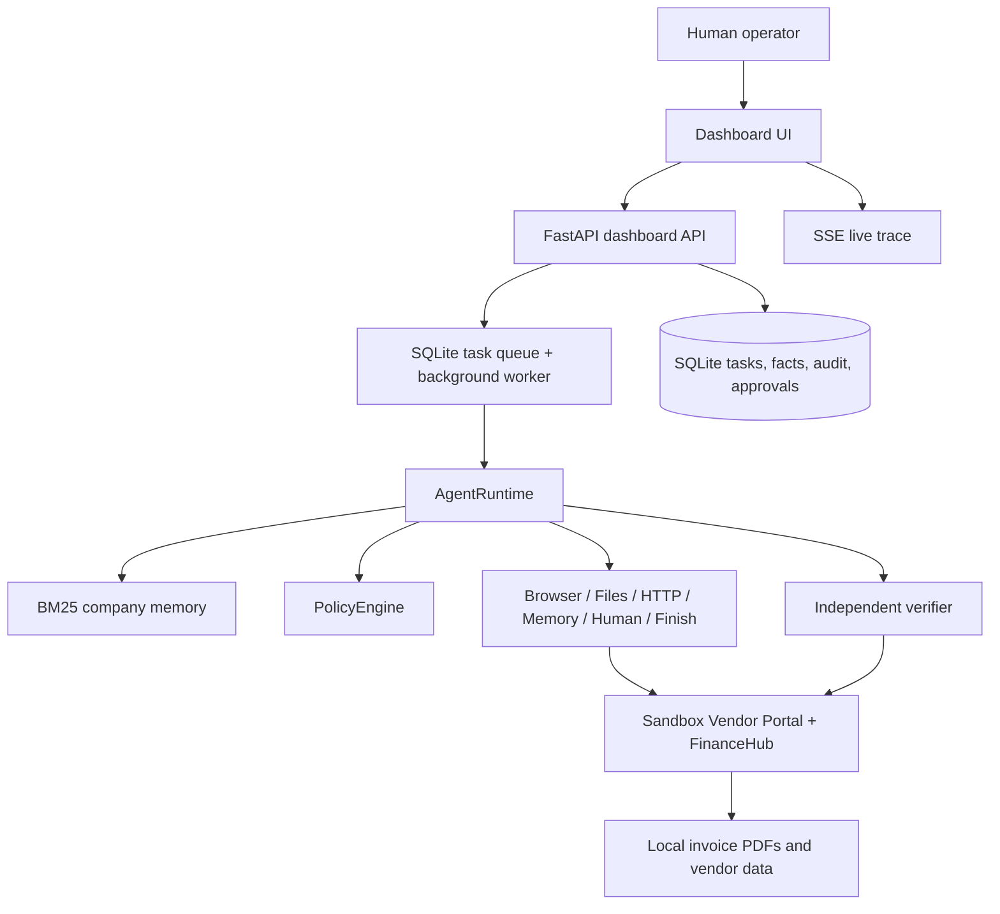

# Architecture

## Overview

OpsAgent is split into a sandbox company world, a runtime agent, a SQLite-backed task system, a policy engine, and a dashboard.

## Runtime loop

The core loop is Goal -> Understand -> Plan -> Execute -> Observe -> Adapt -> Verify -> Complete.

1. The task enters the database queue.
2. The worker starts the runtime.
3. The runtime loads relevant company context with BM25.
4. The runtime calls Gemini 2.5 Flash with tool declarations.
5. Before each tool call, the policy engine checks risk, domain, approval threshold, and content safety.
6. The tool executes in the sandbox.
7. Results are fed back into the conversation and the plan is revised if needed.
8. The verifier re-fetches the created bill and compares it with the source invoice.
9. Completion or correction occurs depending on the comparison result.

## Key assumptions

- Local sandbox systems are the entire company world.
- All external content is treated as untrusted data.
- FinanceHub validation is deterministic and local.
- Human approval is required for write actions above the configured threshold.

## Why the design is safe

- The policy decision happens in code, not just in prompt instructions.
- Domains are restricted to allowed localhost addresses.
- Deletes are explicitly forbidden.
- The verification loop is independent from the agent itself.
